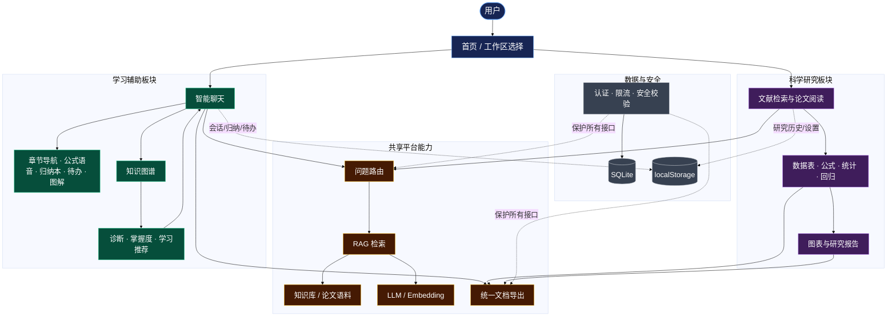

# MathGuide 项目功能关系图

> 精简版：只保留板块之间、核心功能之间和主要数据流。

## 三条核心关系

1. **学习闭环**：智能聊天 → 知识图谱 → 诊断与推荐 → 回到针对性学习。
2. **研究闭环**：文献检索 → 论文阅读 → 数据表分析 → 图表与研究报告。
3. **共享能力**：学习和研究都经过问题路由、RAG、模型调用、统一导出，并受到统一认证与安全校验保护。

## 数据归属

- `知识库 / 论文语料`：供聊天、文献阅读和研究问答检索。
- `SQLite`：保存账号、令牌、用量和诊断记录。
- `localStorage`：保存浏览器侧会话、归纳本、待办、研究历史和设置。
